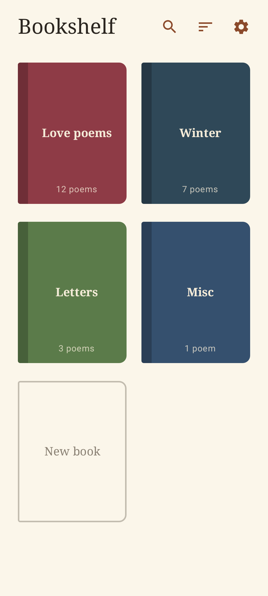
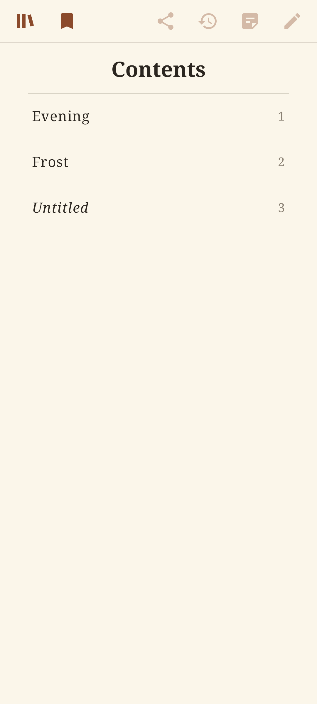
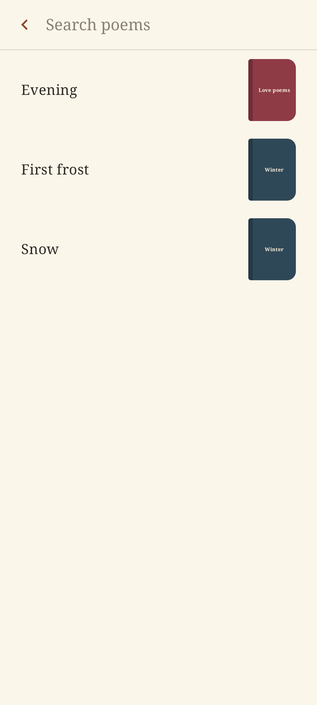
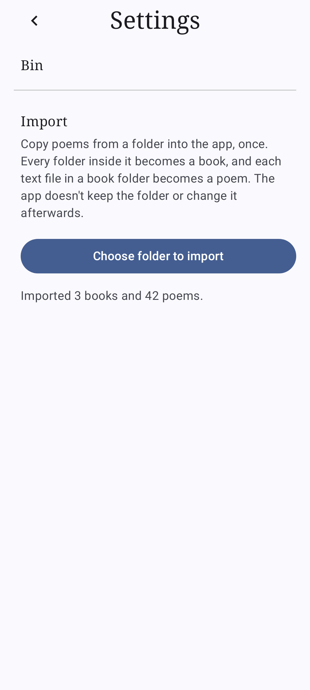
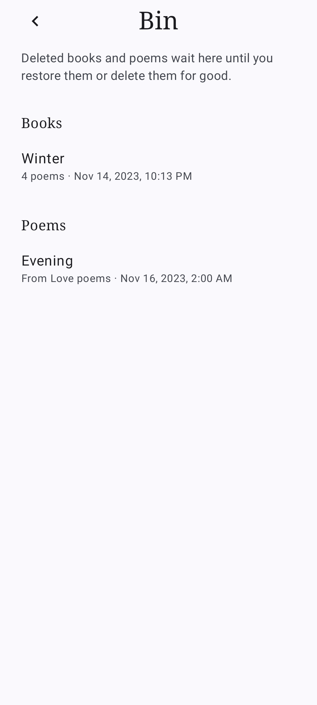

<!-- Generated from readme.yml by LukeNeedham/ci-workflows (docs/readme.md). Edit readme.yml, not this file. -->
<p align="center">
  
</p>

# PoetryBook

An Android book for your own poetry.

## Description

PoetryBook is an Android book for your own poetry. Every page is a poem you wrote: swipe across the page to turn it,
tap the pencil to change it. Pages peel off with a page-curl effect, and the book always ends with one blank,
unstarted poem, ready to be written in.

Books sit on a shelf, each a cover you can create, rename, recolour and delete. A contents sheet drops from the top
to jump to any poem. Saving an edit keeps a new version of the poem, so its history lists every earlier version to
read and copy, and a notepad beside the poem holds rhymes and ideas. Deleted books and poems wait in the bin until
you restore them or delete them for good, and a one-off import copies a folder of text files into the app.

## Screenshots







## Getting started as a user

1. Install the latest build from the [AppHub](https://www.lukeneedham.com/apphub) app, or download the APK from the [Releases](https://github.com/LukeNeedham/PoetryBook/releases) page.

Requires Android 8.0 (API 26) or newer.

## Getting started as a developer

Requirements: JDK 17 and the Android SDK (platform 37), for example through Android Studio.

```
git clone https://github.com/LukeNeedham/PoetryBook.git
cd PoetryBook
./gradlew assembleDebug    # the APK is in app/build/outputs/apk/debug/
./gradlew test             # unit tests
```

Every pull request is built by CI, which comments on it with a link to install the APK.

Like all my apps, it follows the shared architecture and conventions (single activity, Jetpack Compose, Navigation 3, MVVM with every page split into a `Page` and a `PageContent`, Koin): see [ci-workflows](https://github.com/LukeNeedham/ci-workflows/blob/main/docs/new-app.md).

Everything is stored in a Room database, not in files. The schema and the rule that migrations must never be
destructive are in [docs/database.md](docs/database.md).

One `PoemBookViewModel` owns the shelf, the open book and the bin, and is passed to every page; the pages are
`XPage` plus a stateless `XPageContent`, each in its own file. The page turn is in `pageturn/` (`PageTurnBook` shows composable pages one
at a time and curls between them; `geometry/` and `turn/` are the framework-free curl maths from
[TurnThePage](https://github.com/LukeNeedham/TurnThePage)). Import (`DirectoryImporter`) reads a folder through
the Storage Access Framework: every subfolder is a book and every `.txt` file in it a poem, with loose files going
into a book called Misc.

## Contributing

Branch from `main`, make the change, and open a pull request. CI must be green before it is merged.

## License

All rights reserved. See [LICENSE](LICENSE).
