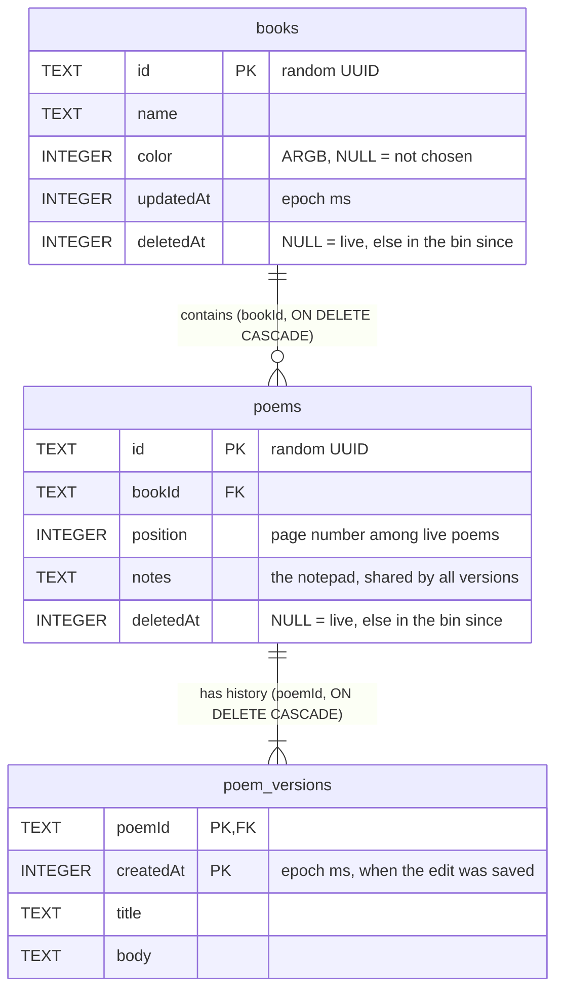

# Database

PoetryBook stores everything in one Room (SQLite) database, `poetrybook.db`, version 1.
Entities are in `data/db/Entities.kt`, queries in `data/db/Daos.kt`, and every multi-step operation
in `data/PoemStore.kt` (each of those is one transaction).

## Entity-relationship diagram

## Tables

### `books`
A book on the shelf.

| Column | Type | Why |
| --- | --- | --- |
| `id` | TEXT, PK | Random UUID, generated in the app. Not an auto-increment number because ids must be creatable without a round trip, and must never be reused or guessable from order. |
| `name` | TEXT, NOT NULL | Not unique: two books may share a name. |
| `color` | INTEGER, NULL | Cover colour as ARGB. NULL means the user never picked one; the UI derives a default from the name, so the default isn't frozen into the data. |
| `updatedAt` | INTEGER, NOT NULL | When a poem in the book last changed (or the book was made). **Stored on purpose**, a denormalised value: the shelf sorts by it, an import sets it from the files' times, and it must not jump when a poem is binned or restored. Deriving it from `MAX(poem_versions.createdAt)` would be a three-table aggregate per book per shelf refresh and could not represent those cases. |
| `deletedAt` | INTEGER, NULL | Soft delete. NULL = live; otherwise the book is in the bin since that time. |

### `poems`
The identity of a poem, plus what belongs to the poem as a whole rather than to one version.

| Column | Type | Why |
| --- | --- | --- |
| `id` | TEXT, PK | Random UUID. |
| `bookId` | TEXT, NOT NULL, FK → `books.id` ON DELETE CASCADE | Many poems to one book. Cascade means wiping a book for good wipes its poems and (via the next cascade) their history, so nothing can be orphaned. |
| `position` | INTEGER, NOT NULL | Page number from 0 among the book's live poems. Kept dense for live poems by `PoemStore`. **Not UNIQUE** with `bookId`: moving a poem shifts a range of rows with one `UPDATE position = position ± 1`, and SQLite checks a unique index row by row, so the statement could fail half way. For a binned poem it holds the page it had so restore can put it back; it plays no part in ordering then. |
| `notes` | TEXT, NOT NULL, default `''` | The notepad. One per poem, shared by all its versions (so ideas can be carried between versions), hence a plain one-to-one column here, and not part of `poem_versions`. |
| `deletedAt` | INTEGER, NULL | Soft delete, as in `books`. |

Index: `(bookId, deletedAt, position)`. It answers "the live poems of this book in page order",
the hottest query, without a sort, and its first column also covers the foreign key.

### `poem_versions`
Append-only history. A poem's current title and text are those of its newest row.

| Column | Type | Why |
| --- | --- | --- |
| `poemId` | TEXT, FK → `poems.id` ON DELETE CASCADE | Deleting a poem for good wipes its history. |
| `createdAt` | INTEGER | When the edit was saved. Together with `poemId` it is the **primary key**. A timestamp alone would not be unique across poems (an import writes hundreds in the same millisecond), so the key is the pair; the app also keeps one poem's timestamps strictly increasing. |
| `title`, `body` | TEXT, NOT NULL | The poem at that moment. Whole-text snapshots, not diffs: poems are short, snapshots make "show me version X" a single-row read, and a corrupted row can't break later versions. |

The primary key index serves the foreign key, "newest version of a poem" (`MAX(createdAt)`) and
the history list (`ORDER BY createdAt DESC`).

**Why the current text isn't also stored on `poems`:** that would store each fact twice and
let the two drift apart. The cost is a lookup of the newest version, which is an index probe.

**Notes are not versioned**, by design: they live on `poems`.

## Rules the code keeps

- Every poem has at least one version: a poem row and its first version are inserted in the same transaction.
- A new version is written only if the title or body differs from the newest one (`isNewVersion`). Versions are never updated or deleted individually.
- Binning is a soft delete (`deletedAt`), reversible; "delete forever" is a real `DELETE` and cascades.
- Binning a book leaves its poems untouched. Binned poems of a binned book are hidden from the poem bin (the bin query requires the book to be live) and come back into view if the book is restored.
- Binning a poem closes the gap in the live positions (`shiftDown`); restoring opens a gap at its remembered page (`shiftUp`), clamped to the end if the book has shrunk.
- Foreign keys are enforced (Room enables them), so all cascades are real.

## Migrations
Version 1 is the first schema. There is deliberately no `fallbackToDestructiveMigration`: a schema
change needs a real migration so users never lose poems. The schema is exported to `app/schemas/`
by the build; commit it so migrations can be tested against it.

## Choices considered and rejected
- **Separate "deleted" tables** that rows are copied into: duplicates the schema, makes restore a copy-back that must remap relations, and would need the same for versions. A nullable `deletedAt` keeps one copy of each row and makes restore an UPDATE.
- **A `currentVersion` pointer on `poems`**: a second source of truth that must be kept in step with the versions table.
- **Auto-increment integer ids**: fine for a single device, but UUIDs make rows creatable anywhere and leave room for sync or backup merging later.
- **Diff-based history**: smaller on disk but needs replaying to read a version, and one bad diff breaks everything after it.
