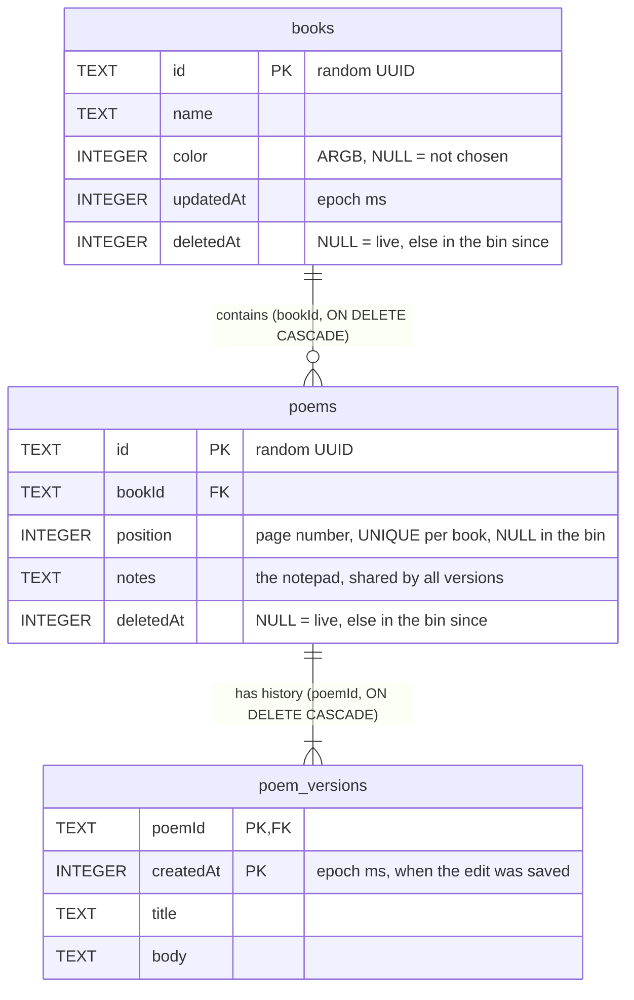

# Database

PoetryBook stores everything in one Room (SQLite) database, `poetrybook.db`, version 1.
Entities are in `data/db/Entities.kt`, queries in `data/db/Daos.kt`, and every multi-step operation
in `data/PoemStore.kt` (each of those is one transaction).

## Entity-relationship diagram

## Tables

### `books`
A book on the shelf.

| Column | Type | Why |
| --- | --- | --- |
| `id` | TEXT, PK | Random UUID, generated in the app. Not an auto-increment number because ids must be creatable without a round trip, and must never be reused or guessable from order. |
| `name` | TEXT, NOT NULL | Not unique: two books may share a name. |
| `color` | INTEGER, NULL | Cover colour as ARGB. NULL means the user never picked one; the UI derives a default from the name, so the default isn't frozen into the data. |
| `updatedAt` | INTEGER, NOT NULL | When a poem in the book last changed (or the book was made). **Stored on purpose**, a denormalised value: the shelf sorts by it, an import sets it from the files' times, and it must not jump when a poem is binned or restored. Deriving it from `MAX(poem_versions.createdAt)` would be a three-table aggregate per book per shelf refresh and could not represent those cases. |
| `deletedAt` | INTEGER, NULL | Soft delete. NULL = live; otherwise the book is in the bin since that time. |

### `poems`
The identity of a poem, plus what belongs to the poem as a whole rather than to one version.

| Column | Type | Why |
| --- | --- | --- |
| `id` | TEXT, PK | Random UUID. |
| `bookId` | TEXT, NOT NULL, FK → `books.id` ON DELETE CASCADE | Many poems to one book. Cascade means wiping a book for good wipes its poems and (via the next cascade) their history, so nothing can be orphaned. |
| `position` | INTEGER, NULL | Page number from 0 among the book's live poems: **dense** (0, 1, 2… with no gaps) and **unique per book**, enforced by the unique index. **NULL exactly when the poem is in the bin**: a binned poem has no page, and restoring puts it at the end of the book. Because SQLite treats NULLs as distinct, any number of binned poems fit under the unique index. |
| `notes` | TEXT, NOT NULL, default `''` | The notepad. One per poem, shared by all its versions (so ideas can be carried between versions), hence a plain one-to-one column here, and not part of `poem_versions`. |
| `deletedAt` | INTEGER, NULL | Soft delete, as in `books`. |

Index: **unique** `(bookId, position)`. It makes the page order a database guarantee (two live poems
can never share a page), answers "the live poems of this book in page order" without a sort, and its
first column also covers the foreign key.

**Invariant the app keeps** (SQLite can't declare it through Room): `deletedAt` is NULL if and only if
`position` is not NULL.

**Changing pages without clashing.** SQLite checks a unique index after every row an `UPDATE` changes,
not at the end of the statement, so `SET position = position - 1` over a range can briefly put two
poems on one page and fail. Instead, `PoemDao` works in two steps inside one transaction: first the
affected rows are *parked* on negative pages (which can't clash with real pages or with each other), then
moved to their final page. Closing the gap left by a binned poem uses `parkAfter` then
`settleParkedDown`; reordering uses `parkPositions` then `setPosition` for each poem.

### `poem_versions`
Append-only history. A poem's current title and text are those of its newest row.

| Column | Type | Why |
| --- | --- | --- |
| `poemId` | TEXT, FK → `poems.id` ON DELETE CASCADE | Deleting a poem for good wipes its history. |
| `createdAt` | INTEGER | When the edit was saved. Together with `poemId` it is the **primary key**. A timestamp alone would not be unique across poems (an import writes hundreds in the same millisecond), so the key is the pair; the app also keeps one poem's timestamps strictly increasing. |
| `title`, `body` | TEXT, NOT NULL | The poem at that moment. Whole-text snapshots, not diffs: poems are short, snapshots make "show me version X" a single-row read, and a corrupted row can't break later versions. |

The primary key index serves the foreign key, "newest version of a poem" (`MAX(createdAt)`) and
the history list (`ORDER BY createdAt DESC`).

**Why the current text isn't also stored on `poems`:** that would store each fact twice and
let the two drift apart. The cost is a lookup of the newest version, which is an index probe.

**Notes are not versioned**, by design: they live on `poems`.

## Rules the code keeps

- Every poem has at least one version: a poem row and its first version are inserted in the same transaction.
- A new version is written only if the title or body differs from the newest one (`isNewVersion`). Versions are never updated or deleted individually.
- Binning is a soft delete (`deletedAt`), reversible; "delete forever" is a real `DELETE` and cascades.
- Binning a book leaves its poems untouched. Binned poems of a binned book are hidden from the poem bin (the bin query requires the book to be live) and come back into view if the book is restored.
- Binning a poem sets its `position` to NULL and closes the gap among the live poems (park, then settle). Restoring appends: the poem gets the next page (the live count). **A restored poem does not get its old page back**; that was a deliberate simplification, so a binned poem stores no stale page.
- Live pages are always exactly 0..n-1 per book. `reorder` rebuilds them from the order it is given and appends any live poem missing from that list, so the pages stay complete.
- Foreign keys are enforced (Room enables them), so all cascades are real.
- **Migrations never destroy data** (see [Migrations: never destructive](#migrations-never-destructive)).

## Migrations: never destructive

> **Rule: a schema change must never delete, reset or recreate user data. Destructive migrations are forbidden.**

This database holds the only copy of someone's poems and every earlier version of them. The version
history exists so that nobody is afraid of losing work; a migration that wipes it would defeat the
whole point of the app. So:

- **Never** call `fallbackToDestructiveMigration()`, `fallbackToDestructiveMigrationOnDowngrade()`,
  `fallbackToDestructiveMigrationFrom(...)` or any variant, in any build (debug included, so the
  habit never reaches release).
- **Never** write a migration that drops a table or column holding user data without first copying
  that data somewhere it is kept, and never one that deletes rows.
- **Never** bump `version` without adding a `Migration` (or an `@AutoMigration` that Room has
  verified) from the previous version, written and tested in the same change.
- **Never** lower the version or ship a build that opens a newer database than it understands
  without a plan; Room will refuse to open it, and that refusal must not be "fixed" by wiping.
- **Never** "fix" a failed or crashing migration by clearing app data or deleting the database
  file. Fix the migration.
- Destructive-looking SQL such as `DROP TABLE`, `DELETE FROM` and `ALTER TABLE ... DROP COLUMN` is
  allowed in a migration only as part of the usual SQLite table rebuild (create new table, copy
  every row across, drop old, rename), and the test must prove the rows survived.

What to do instead:

1. Change the entities and raise `version` by one.
2. Write the `Migration(from, to)` (or an auto-migration for simple additions) and register it in
   `PoetryDatabase` with `addMigrations(...)`.
3. Keep the exported schema JSON for **every** version in `app/schemas/` and never edit or delete an
   old one. Room writes the new one on build; commit it.
4. Test the migration with `MigrationTestHelper` against the old schema JSON: create the old
   database, insert rows, migrate, and assert that every row and relation is still there.

`NoDestructiveMigrationTest` (a unit test, run on every pull request by the `unit-tests` job in `.github/workflows/trigger_on_pull_request.yml`, so it fails the PR) enforces the first rule mechanically: it
scans the app's source code, ignoring comments, and fails on any `fallbackToDestructiveMigration…`
call, `clearAllTables` or `deleteDatabase`. It cannot prove that a migration keeps every row; that is
what the per-migration `MigrationTestHelper` test is for. If the guard ever fails, fix the code; do not
edit the guard.

Version 1 is the first schema, and its exported JSON is committed at `app/schemas/com.lukeneedham.poetrybook.data.db.PoetryDatabase/1.json`. As long as there is no released data, nothing needs migrating, but
the rule applies from the first release on, and adding the fallback "just while developing" is how
it ends up shipped.

If a change truly cannot be migrated without losing data (it should be very rare), stop and ask
the owner. The answer is never to wipe silently; at minimum the user must be shown what will be lost and
export their poems first.

## Choices considered and rejected
- **Keeping a binned poem's old page** (in `position`, or in a second column) so restore could put it back: more state and an extra shift on restore, and the stale value broke uniqueness. Restore-to-the-end is simpler and lets the unique index hold.
- **Gapped or fractional page keys** (10, 20, 30… or 1.5): they avoid renumbering, but a book holds tens of poems, so renumbering a few rows costs nothing, and the extra complexity only pays off with sync or huge lists.
- **No uniqueness on `position`** (the first version of this schema): a bug in the shifting could then silently leave two poems on one page. The unique index turns that into a loud failure.
- **Separate "deleted" tables** that rows are copied into: duplicates the schema, makes restore a copy-back that must remap relations, and would need the same for versions. A nullable `deletedAt` keeps one copy of each row and makes restore an UPDATE.
- **A `currentVersion` pointer on `poems`**: a second source of truth that must be kept in step with the versions table.
- **Auto-increment integer ids**: fine for a single device, but UUIDs make rows creatable anywhere and leave room for sync or backup merging later.
- **Diff-based history**: smaller on disk but needs replaying to read a version, and one bad diff breaks everything after it.
